# Billable

**Local-first time tracking and invoicing for freelancers.** Track billable hours per client with a start / pause / stop / save timer, log expenses with receipt photos, and generate PDF invoices with itemized regional sales tax. It runs in a browser or as a Windows desktop app, stores everything on your own device, and needs no server, no account and no network.

<p align="center">
  
</p>

<p align="center">
  The slideshow above plays on its own. For an interactive version (previous / next, dots, thumbnails, arrow keys, pause), open <a href="docs/showcase.html"><code>docs/showcase.html</code></a> in a browser after cloning the repo.
</p>

<details>
<summary>Static screenshots</summary>

| | | |
|---|---|---|
| 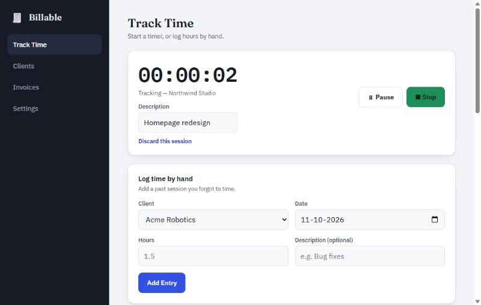<br>Timer | 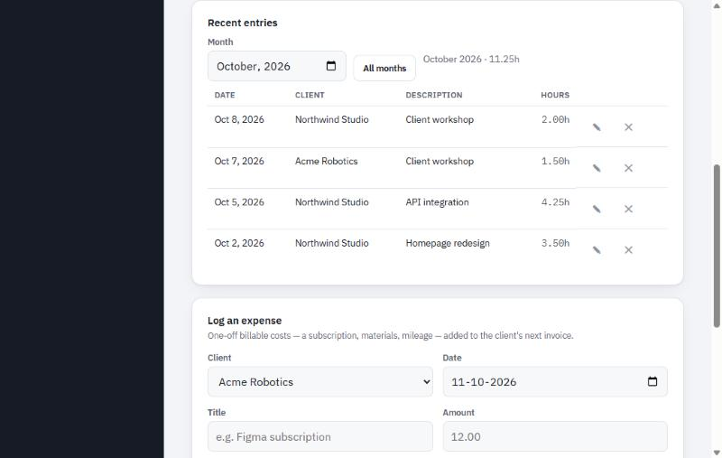<br>Recent entries, month filter | 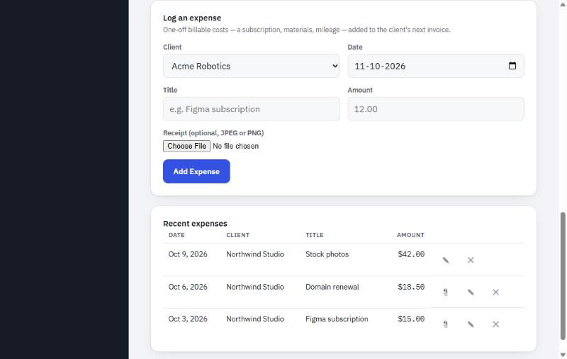<br>Expenses and receipts |
| 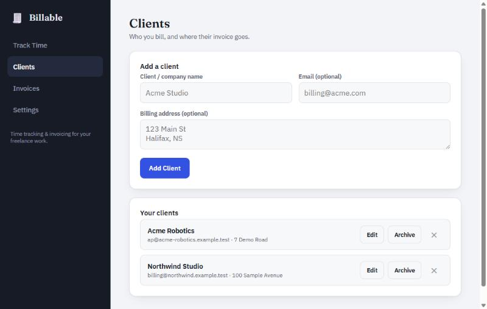<br>Clients | 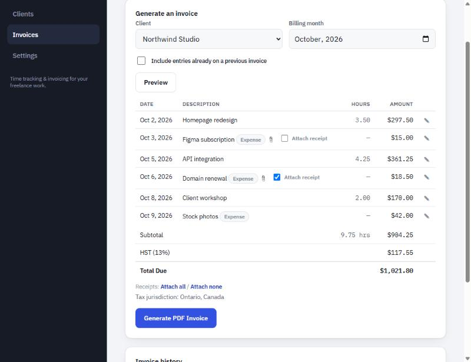<br>Invoice preview | 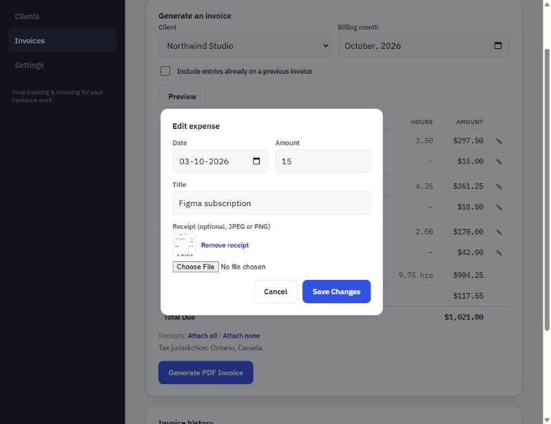<br>Edit from the preview |
| 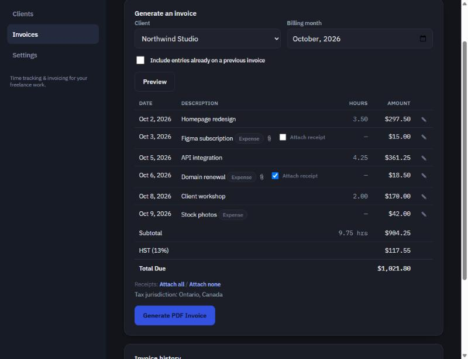<br>Dark theme | 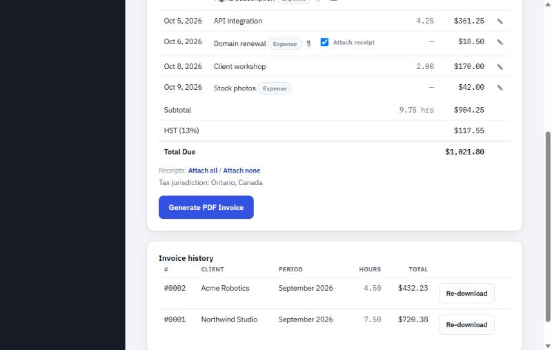<br>Invoice history | 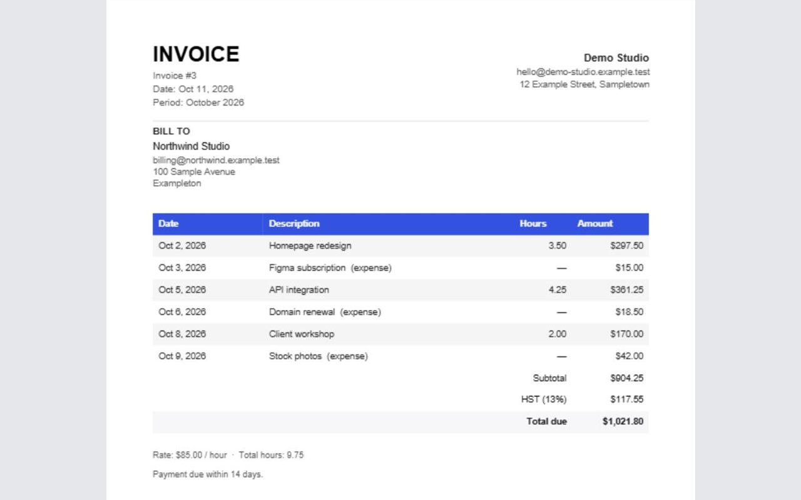<br>Generated PDF |

</details>

All screenshots use made-up demo data.

---

## Contents

1. [Features](#features)
2. [Quick start](#quick-start)
3. [Desktop app (Windows): install guide](#desktop-app-windows)
4. [How it works: animated architecture](#how-it-works-animated-architecture)
5. [Data model](#data-model)
6. [Testing](#testing)
7. [Project layout](#project-layout)
8. [Security and privacy](#security-and-privacy)
9. [Roadmap](#roadmap)
10. [License](#license)

---

## Features

| Feature | What it does | Main modules | What is stored |
|---|---|---|---|
| **Timer** | Start, pause, resume, stop and save a session for a client. A stopped session can be resumed or saved as a time entry dated with your **local** day. The running state survives a reload, and the browser/window title shows the live state (`▶ 00:12:03 — Client · Billable`). Starting a second timer while one is active is ignored. | `ui/track.js`, `domain/timer.js` | `state/timer` (per device) |
| **Time entries** | Log time by hand (0.01 h or more) or from the timer. Edit, delete, and filter **Recent entries by month** with the month's total hours. Newest first, with a stable order for same-day entries. | `ui/track.js`, `ui/dialogs.js`, `domain/dates.js`, `domain/order.js` | `entries` |
| **Expenses and receipts** | One-off billable costs added to a client's next invoice. Attach a JPEG or PNG receipt (compressed to 1400 px on the longest side). View, replace or remove it; "Clear selected file" discards a freshly picked file. | `ui/track.js`, `ui/dialogs.js`, `lib/receipts.js` | `expenses` (receipt fields inline) |
| **Clients** | Add, edit, archive/unarchive and delete clients. Archived clients leave the timer and expense dropdowns but stay selectable for invoices. Case-insensitive alphabetical list. | `ui/clients.js` | `clients` |
| **Invoice preview** | Pick a client and month and preview every un-invoiced time entry and expense with subtotal, tax lines and total. Changing the month, client or the "include already invoiced" box clears a stale preview. | `ui/invoices.js`, `services/invoices.js`, `domain/invoiceTotals.js` | nothing until you generate |
| **Edit inside the preview** | An Edit button on **every** line opens the entry or expense editor. After saving, the preview reloads and the totals, tax and PDF data update. If an edit moves a line to another month it drops out with a notice. | `ui/invoices.js`, `ui/dialogs.js` | `entries`, `expenses` |
| **Choose which receipts to attach** | Each expense with a receipt has an "Attach receipt" tick (default on), plus "Attach all / Attach none". Only ticked receipts become PDF pages, and your choice stays as you left it when you edit the expense. | `ui/invoices.js`, `services/invoices.js` | the saved invoice keeps only attached receipts |
| **PDF invoices** | Letter-size PDF with business block, bill-to, line items, itemized tax, total due, rate/hours line, notes and one receipt per page. Totals appear once on the last page, long notes continue on new pages, amounts are formatted like `$1,234.50`. | `services/invoicePdf.js` (jsPDF + autotable) | — |
| **Invoice history** | Every generated invoice is an immutable snapshot (client, business, rate, lines, tax, receipts), so **Re-download** reproduces the same PDF even after you change rates or rename clients. | `ui/invoices.js`, `services/invoices.js` | `invoices` |
| **Sales tax** | Canada: pick a province for HST / GST+PST / GST+QST / GST-only. Anywhere else: up to two custom tax lines. Rounding is per entry, then per tax line. | `domain/tax.js`, `ui/settings.js` | `settings/main` |
| **Settings** | Hourly rate, currency symbol, next invoice number, business details and payment notes shown on invoices. A banner reminds you until rate and business name are set. | `ui/settings.js` | `settings/main` |
| **Themes and fonts** | Light and dark follow the system. Fraunces and IBM Plex are bundled locally, so nothing is fetched from the internet. | `style.css`, `fonts.css` | — |
| **Desktop app** | Windows installer (Electron), native Save dialog for invoices (cancel it and nothing is recorded), locked-down window, content-security policy, offline. | `electron/*` | same local store |

> Everything is local. There is no cloud sync or login yet; see the [roadmap](#roadmap).

---

## Quick start

Requires **Node 22.12 or newer** (24 is fine).

```bash
npm install
npm run dev          # http://localhost:5173
```

| Command | What it does |
|---|---|
| `npm run dev` | Vite dev server |
| `npm run build` | Production build into `dist/` (plain static files, deployable anywhere) |
| `npm run preview` | Serve the production build locally |
| `npm test` | Run the unit and integration tests (Vitest) |
| `npm run electron:dev` | Build, then open the desktop window |
| `npm run smoke` | End-to-end smoke test of the desktop shell |
| `npm run dist` | Build the Windows installer |

Data is stored in the browser's IndexedDB for the origin you are on, so `localhost:5173` and a deployed domain are separate stores, and clearing site data clears the app's data.

### First run

1. **Settings**: enter your hourly rate, currency symbol and business details. Choose Canada plus a province for automatic tax, or enter your own rate(s).
2. **Clients**: add at least one client.
3. **Track Time**: run the timer or log time by hand; log expenses (with receipts) below.
4. **Invoices**: choose a client and month, **Preview**, optionally edit lines and untick receipts, then **Generate PDF Invoice**.

---

---

## Desktop app (Windows)

**Download:** get `Billable-Setup-1.0.0.exe` from the [Releases page](https://github.com/patel24kishan/billable-app/releases) (see [Install](#install) below), or build it yourself with `npm run dist`.

The same app also ships as a Windows desktop app (Electron 44, Windows x64). It runs fully offline, keeps its data on your computer, and has no account, no sync and no auto-update.

### Run it in development

```bash
npm install
npm run electron:dev     # vite build, then opens the app window (electron .)
```

`npm run electron:start` opens the window on the existing `dist/` build without rebuilding.

### Build the installer

```bash
npm run dist             # vite build + electron-builder (NSIS, Windows x64)
```

Output in `release/`:

- `Billable-Setup-1.0.0.exe`: the installer (about 120 MB). This is the file to give to users.
- `win-unpacked/Billable.exe`: the unpacked app, for testing without installing.
- `Billable-Setup-1.0.0.exe.blockmap`, `builder-debug.yml`: build by-products; not needed for installing.

electron-builder downloads the Electron runtime and the NSIS tools from GitHub on the first build (cached in `%LOCALAPPDATA%\electron-builder\Cache`), so the first `npm run dist` needs network access. The packaged app contains only `dist/` (without source maps), `electron/` and `package.json`.

### Install

1. Run `Billable-Setup-1.0.0.exe`.
2. **Windows SmartScreen:** the installer is not code-signed, so Windows may show "Windows protected your PC". Click **More info**, then **Run anyway**. (Only do this for an installer you built yourself or got from a source you trust.)
3. Choose **Only for me** (the default; no administrator rights needed). "Anyone who uses this computer" is also offered but asks for administrator rights.
4. Pick the install folder (default for "Only for me": `%LOCALAPPDATA%\Programs\Billable`) and finish. The installer creates a desktop shortcut and a Start-menu entry named **Billable**.

### Where your data lives

The desktop app stores its data (IndexedDB) in Electron's user-data folder: **`%APPDATA%\billable`** (for example `C:\Users\<you>\AppData\Roaming\billable`). The folder is named after the package `name` (`billable`); Windows paths are not case-sensitive, so `%APPDATA%\Billable` is the same folder. This data is separate from the browser version's data; nothing is migrated between them. Saved invoice PDFs go wherever you choose in the save dialog (default: your Downloads folder).

### Uninstall

Open **Settings → Apps → Installed apps**, find **Billable**, and choose **Uninstall** (or run "Uninstall Billable.exe" in the install folder). The uninstaller removes the program files and the shortcuts but **keeps your data** in `%APPDATA%\billable` (`deleteAppDataOnUninstall` is deliberately off), so reinstalling brings your clients, entries and invoices back. To erase the data too, delete that folder by hand after uninstalling. Invoice PDFs you saved are never touched.

### Smoke test

```bash
npm run smoke                                              # dev layout: vite build, then electron . with BILLABLE_SMOKE=1
node scripts/smoke.mjs release/win-unpacked/Billable.exe   # the packaged app (after npm run dist)
```

The smoke run uses a fresh temporary user-data folder (the app refuses any folder outside the temp folder), adds a client, generates an invoice, saves the PDF into that temp folder, prints `SMOKE OK` and exits 0. Stack traces mentioning "Invalid save request" on stderr are expected (the smoke sends deliberately bad save requests).

### Notes

- **Placeholder icon:** `build/icon.png` (a blue tile with a white "B") is a placeholder made by `npm run icon` (`scripts/make-icon.mjs`, no dependencies). Replace it with a real logo (PNG, at least 512x512) before a public release; electron-builder converts it to the Windows `.ico`. Re-running the generator overwrites a replaced icon.
- **No auto-update:** publishing is disabled (`"publish": null`); to update, build a newer installer and run it over the old install (your data is kept).
- **Electron runtime download:** since Electron 42 the `electron` npm package no longer downloads its runtime during `npm install`; it downloads it (into `%LOCALAPPDATA%\electron\Cache`, verified against `node_modules/electron/checksums.json`) the first time `electron .` / `npm run smoke` runs, so that first run needs network access. To fetch it ahead of time run `npx install-electron --no`. If a run ever fails with "Electron failed to install correctly", delete `node_modules/electron` and run `npm install` and `npx install-electron --no` again. `npm run dist` is not affected: electron-builder downloads and unpacks its own copy of Electron.

---

## How it works: animated architecture

The diagrams animate: the moving dots follow the order of each flow. They are plain SVG (no scripts), so they play on GitHub and in most editors. The module and function names in them are the real ones in `src/` and `electron/`.

### Overview: layers and module map


Screens (`src/ui/*`) read and write through one **store seam** (`src/lib/store`). The store is the only code that touches IndexedDB, stamps `createdAt` / `updatedAt`, and notifies listeners, so the UI re-renders from `onSnapshot` callbacks. Business rules live in pure modules (`src/domain/*`) and services (`src/services/*`) that have no DOM access, which keeps them easy to test and reuse. In the desktop app, Electron's main process only adds a window and a save bridge; the renderer is the same web app.

### Timer


Every transition writes the `state/timer` document, so the timer survives reloads. Saving turns the stopped session into a time entry dated with the local day of the start, then resets the timer.

### Time entries and the month filter


The Recent entries list is a live query: optional date range (`where`), ordered by date and creation time (newest first), with an id tiebreak so the order never depends on storage internals.

### Expenses and receipts


A receipt is validated (JPEG or PNG), downscaled and stored with the expense through the `lib/receipts.js` seam, so a future cloud store can move images to blob storage without touching screens.

### Clients


### Invoice flow: preview, edit, generate, save, record


1. **Preview** queries entries and expenses for the client and month, orders them, and sets the receipt ticks.
2. **Edit** (optional) reloads the preview after each saved change.
3. **Totals** come from one function, `computeInvoiceTotals`, used by both the preview and the invoice snapshot, so the screen, the PDF and the history always agree.
4. **Generate** builds the snapshot (`buildInvoiceDoc`), renders the PDF (`buildPdfDoc`) and asks `downloads.save` to save it: a browser download on the web, a native Save dialog on the desktop.
5. **Record** happens only if the save was not declined: the invoice is stored, its lines are marked invoiced and the next invoice number is bumped. The preview then clears so a second click cannot create a duplicate.

### Settings and tax


### Desktop shell and security


### Prepared for the future: sync and Android


Dashed boxes are **planned, not built**. The code is already shaped for them: string ids, `createdAt` / `updatedAt` on every record, one store interface, a receipts interface, and pure domain modules.

---

## Data model

Everything lives in one IndexedDB database (`billable`, object store `documents`). The full field-by-field tables, defaults, who writes each field and an entity diagram are in **[docs/architecture/data-model.md](docs/architecture/data-model.md)**. In short:

| Collection | Holds | Key facts |
|---|---|---|
| `clients` | name, email, address, `archived` | editing never changes `archived` |
| `entries` | clientId, clientName, date, description, seconds, `invoiced`, `invoiceId` | `date` is the local day (`YYYY-MM-DD`) |
| `expenses` | clientId, clientName, date, title, amount, receipt fields, `invoiced`, `invoiceId` | receipt stored as a compressed data URL |
| `invoices` | full snapshot: number, month, from, to, currency, rate, line items, tax lines, totals, receipts | immutable; re-download rebuilds from it |
| `settings/main` | rate, currency, next invoice number, business info, notes, tax setup | one document |
| `state/timer` | the current timer session | per device, never part of an invoice |

---

---

## Testing

```bash
npm test
```

About 320 tests in 39 files (Vitest, jsdom, fake-indexeddb): pure-logic unit tests (money, tax, totals, ordering, timer, PDF layout) and integration tests that boot the real app against an in-memory IndexedDB and drive the real forms. Every behavior change in the project's history was added together with a test that fails on the old code. The desktop shell has its own end-to-end smoke test (`npm run smoke`).

---

## Project layout

```
index.html              page shell for the four screens (Track, Clients, Invoices, Settings)
src/main.js             boot only: bind screens, open the store, subscribe in a fixed order
src/state.js            the one shared state object
src/ui/                 screens: track, clients, invoices, settings, dialogs, nav, toast, dom
src/domain/             pure rules: money, dates, tax, invoice totals, timer state machine, ordering
src/services/           invoice snapshot/recording (invoices.js) and PDF builder (invoicePdf.js)
src/lib/store/          the store seam: createStore, local IndexedDB implementation
src/lib/receipts.js     receipt compression and field helpers
src/lib/downloads.js    save a PDF: browser download or the desktop bridge
src/lib/schema.js       collection names, defaults, createdAt/updatedAt stamping
src/fonts.css           bundled fonts (no network)
electron/               desktop shell: main, preload bridge, save handler, navigation policy, CSP, smoke
scripts/                smoke launcher and the placeholder icon generator
build/icon.png          placeholder app icon
tests/                  unit/ and integration/ tests
docs/                   screenshots, animated architecture diagrams, interactive showcase
plan.md                 the implementation plan and its notes
```

---

## Security and privacy

- **No network use.** There is no server, account, analytics or remote font. Your data never leaves your device.
- **Desktop hardening.** Context isolation and sandbox on, Node access off, a strict content-security policy (no remote hosts, no inline scripts except one hashed handler), navigation and new windows blocked (web links open in your browser), permissions denied, DevTools only in development.
- **Save bridge.** The page can only ask the main process to save bytes; the main process validates the request (trusted sender, size cap, sanitized filename) and the native dialog, not the page, chooses where the file goes.
- **Unsigned installer.** Windows SmartScreen will warn; sign the installer before wide distribution.
- **Tax rates** for Canada were checked in September 2026 but change with every budget; confirm rates before relying on an invoice for a filing. Outside Canada you enter your own rate(s).
- **Back up** by saving invoice PDFs as you go; data is tied to one browser profile or one desktop install.

---

## Roadmap

- Cloud save and login so data syncs across the web, desktop and a future Android app (the code is structured for it; nothing is built yet).
- A shared export/import format so the existing Kotlin Android app (`android-version` branch) and the web/desktop apps can exchange data.
- Replace the placeholder icon, add code signing, and consider an auto-update channel.
- Month filter for Recent expenses; upgrade the PDF library (jsPDF) to a current major.

---

## License

MIT. See [LICENSE](./LICENSE).
