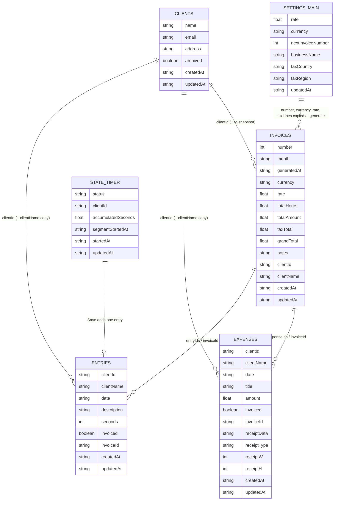

# Data model

Everything Billable stores lives on the device, in one IndexedDB database. Screens never open IndexedDB themselves. They go through the store seam (`src/lib/store/index.js` `createStore()` -> `src/lib/store/localStore.js`), which has a small Firestore-shaped API: `collection(name)`, `doc(path)`, `where` / `orderBy` / `limit`, `get`, `onSnapshot`, `add` / `set` / `update` / `remove`.

## Storage layout

| Item | Value | Source |
|---|---|---|
| Database | `billable`, version `1` | `localStore.js` `DB_NAME`, `DB_VERSION` |
| Object store | `documents`, keyPath `path` | `localStore.js` `STORE` |
| Stored record | `{ path: "<collection>/<id>", data: { ...fields } }`, e.g. `clients/id_k3x9…`, `settings/main`, `state/timer` | `persist()` |
| Collections | `clients`, `entries`, `expenses`, `invoices` | `schema.js` `COLLECTIONS` |
| Single documents | `settings/main`, `state/timer` | `schema.js` `DOCS` |
| Ids | `'id_' + Math.random().toString(36).slice(2) + Date.now().toString(36)`, created by `add()` | `localStore.js` `uid()` |
| Reads | all records are loaded once at start (`getAll`) into an in-memory mirror; queries and `onSnapshot` listeners run on that mirror | `createLocalStore()` |
| Desktop app | the same IndexedDB code, stored in the Electron userData folder (`%APPDATA%\billable` for the installed app; a temp folder for smoke runs) | `electron/main.js`, `electron/smokeGuard.js` |

### Timestamps (added by the store, not by screens)

| Write | `createdAt` | `updatedAt` |
|---|---|---|
| `collection(c).add(data)` | kept if the caller set it, otherwise now (`stampAdd`) | now |
| `doc(p).set(data)` (full replace) | not added (`stampWrite`) | now |
| `doc(p).update(patch)` (merge) | unchanged | now |
| `doc(p).remove()` | record deleted (alias of `delete()`; a soft delete can be added here later) | - |

All timestamps are ISO 8601 UTC strings (`new Date().toISOString()`). `SCHEMA_VERSION = 1` is exported by `schema.js` for a later export/import but is **not** stamped on records yet.

## Collections

### `clients`

| Field | Type | Written by | Notes |
|---|---|---|---|
| `name` | string | `ui/clients.js` add and edit | trimmed, required ("Enter a client name."); lists sort case-insensitively (`localeCompare`, `sensitivity:'base'`, then id) |
| `email` | string | add and edit | trimmed, may be empty |
| `address` | string | add and edit | trimmed, may contain line breaks |
| `archived` | boolean | add (`false`); Archive / Unarchive (`update({archived: !archived})`) | edit does not send it, so editing keeps the archived state. Archived clients are hidden from the Track dropdowns and shown as "(archived)" in the Invoices dropdown |
| `createdAt` | ISO string | `ui/clients.js` on add | |
| `updatedAt` | ISO string | store | every add / update |

Delete is permanent (`remove()`). Entries, expenses and invoices are not deleted with the client; they keep `clientId` and their own `clientName` copy.

### `entries` (time entries)

| Field | Type | Written by | Notes |
|---|---|---|---|
| `clientId` | string | timer save (`domain/timer.js` `entryFromStoppedTimer`), manual form (`ui/track.js`) | id of a `clients` record |
| `clientName` | string | same | copy of the client name at the time of saving; not rewritten when the client is renamed |
| `date` | `'YYYY-MM-DD'` | timer save: `localDateStr(startedAt)` (the local day the session started); manual form: picked date, default `todayStr()`; edit dialog | local date, never the UTC date |
| `description` | string | timer, manual form, edit dialog | trimmed, may be empty (lists show "No description") |
| `seconds` | integer | timer: `Math.round(accumulatedSeconds)`; manual and edit: `Math.round(hours * 3600)` | hours on screen and on invoices are `hoursFromSeconds()` = seconds / 3600 rounded to 2 decimals |
| `invoiced` | boolean | `false` on create; `true` from `recordInvoice` | the preview skips invoiced rows unless "Include entries already on a previous invoice" is ticked |
| `invoiceId` | string | `services/invoices.js` `recordInvoice` | id of the `invoices` record; absent until invoiced |
| `createdAt` | ISO string | timer save / manual form | same-day ordering key (`orderBy('date','desc').orderBy('createdAt','desc')`, then id) |
| `updatedAt` | ISO string | store | |

The edit dialog updates only `date`, `seconds` and `description`.

### `expenses`

| Field | Type | Written by | Notes |
|---|---|---|---|
| `clientId`, `clientName` | string | `ui/track.js` expense form | as for entries |
| `date` | `'YYYY-MM-DD'` | form (default `todayStr()`), edit dialog | required in the edit dialog ("Enter a valid date.") |
| `title` | string | form, edit dialog | trimmed, required |
| `amount` | number | form, edit dialog | `Math.round(amount * 100) / 100`, must be > 0 |
| `invoiced` | boolean | `false` on create; `true` from `recordInvoice` | |
| `invoiceId` | string | `recordInvoice` | absent until invoiced |
| `receiptData` | string (data URL) or `null` | `lib/receipts.js` `receiptFields()` on add or edit; `clearedReceiptFields()` sets `null` | JPEG (quality 0.78) or PNG, longest side at most 1400 px (`fileToCompressedDataUrl`). Absent when an expense was added without a receipt |
| `receiptType` | `'image/jpeg'` / `'image/png'` / `null` | same | |
| `receiptW`, `receiptH` | number (px) / `null` | same | size after downscaling |
| `createdAt` | ISO string | expense form | |
| `updatedAt` | ISO string | store | |

Only `lib/receipts.js` (`hasReceipt`, `getReceipt`, `receiptFields`, `clearedReceiptFields`, `createReceipts(store)`) knows the receipt field names, so receipts can later move to blob storage. The per-invoice "Attach receipt" tick is **not** stored on the expense; it lives on the preview rows only (`attachReceipt`).

### `invoices` (snapshots)

Built by `services/invoices.js` `buildInvoiceDoc()` when Generate is clicked and saved by `recordInvoice()` only after the PDF was saved (a declined save records nothing). A saved invoice never changes when settings or clients change later; history rows and Re-download (`buildPdfDoc(inv)`) read only the snapshot.

| Field | Type | Notes |
|---|---|---|
| `number` | integer | `settings.nextInvoiceNumber` (or 1) at generate time; shown as `#0007` |
| `month` | `'YYYY-MM'` | the previewed billing month |
| `generatedAt` | ISO string | history is ordered by this field, newest first (limit 200) |
| `from` | `{ name, email, address }` | business details from settings |
| `to` | `{ name, email, address }` | the client as loaded for the preview (`'Client'` / empty if missing) |
| `currency` | string | settings currency symbol (default `'$'`); used for every amount in the PDF and the history row |
| `rate` | number | hourly rate at generate time |
| `totalHours` | number | sum of per-entry rounded hours (`computeInvoiceTotals`) |
| `totalAmount` | number | the subtotal before tax |
| `taxLines` | `[{ label, rate, amount }]` | `rate` is a fraction (0.13); `amount = round(subtotal * rate, 2)` |
| `taxTotal` | number | |
| `grandTotal` | number | subtotal + taxTotal (history and PDF fall back to `totalAmount` for older records without it) |
| `notes` | string | invoice notes from settings |
| `lineItems` | `[{ type:'time', date, description, hours, amount }` or `{ type:'expense', date, description, amount }]` | in invoice line order: date asc, time before expense, `createdAt` asc, id asc. Expense `description` is the expense title |
| `receipts` | `[{ title, dataUrl, type, width, height }]` | only the expenses whose receipt was ticked; `type` defaults to `image/jpeg`, size to 800 x 600 when unknown |
| `entryIds`, `expenseIds` | string[] | the records marked `invoiced:true` with this `invoiceId` |
| `clientId`, `clientName` | string | for the history table |
| `createdAt` | ISO string | set by the store (`stampAdd`), since the snapshot has none |
| `updatedAt` | ISO string | store |

## Single documents

### `settings/main`

Written in full by the Settings screen (`doc('settings/main').set(data)`), and merged by `recordInvoice` (`update({ nextInvoiceNumber: n + 1 })`). Reads always merge with `defaultSettings()`, so a missing document or field falls back to the defaults below.

| Field | Type | Default | Notes |
|---|---|---|---|
| `rate` | number | `0` | hourly rate (`parseFloat` or 0) |
| `currency` | string | `'$'` | symbol used by `money()` |
| `nextInvoiceNumber` | integer | `1` | bumped after each recorded invoice |
| `businessName`, `businessEmail`, `businessAddress` | string | `''` | invoice "from" block; the setup banner hides once `rate` and `businessName` are set |
| `notes` | string | `''` | printed under the invoice table |
| `taxCountry` | `''` / `'Canada'` / `'United States'` / `'Other / custom'` | `''` | `''` means no tax |
| `taxRegion` | string | `''` | Canadian province or territory (key of `TAX_TABLES`), only for Canada |
| `taxCustomLabel1`, `taxCustomLabel2` | string | `''` | United States / Other only |
| `taxCustomRate1`, `taxCustomRate2` | number (fraction) | `0` | entered as a percent, stored divided by 100 (8.25 -> 0.0825) |
| `updatedAt` | ISO string | - | store; this document has no `createdAt` |

`domain/tax.js` `getEffectiveTaxLines(settings)` turns these fields into tax lines: Canada -> `TAX_TABLES[taxRegion]`; United States / Other -> each custom line with a label and a rate above 0; otherwise none.

### `state/timer`

The running timer. Per device by design: it is never meant to sync, only the saved entry is. Every transition is a full `set()` (`ui/track.js`), and Save / Discard write `IDLE_TIMER` back.

| Field | Type | Notes |
|---|---|---|
| `status` | `'idle'` / `'running'` / `'paused'` / `'stopped'` | `domain/timer.js` transitions `startTimer`, `pauseTimer`, `resumeTimer`, `stopTimer` |
| `clientId`, `clientName` | string / `null` | chosen at Start |
| `description` | string | editable while the session runs |
| `accumulatedSeconds` | number | seconds from finished segments (fractional until saved) |
| `segmentStartedAt` | ISO string / `null` | start of the current running segment |
| `startedAt` | ISO string / `null` | start of the session; gives the entry's local `date` |
| `updatedAt` | ISO string | store |

## Relationships

